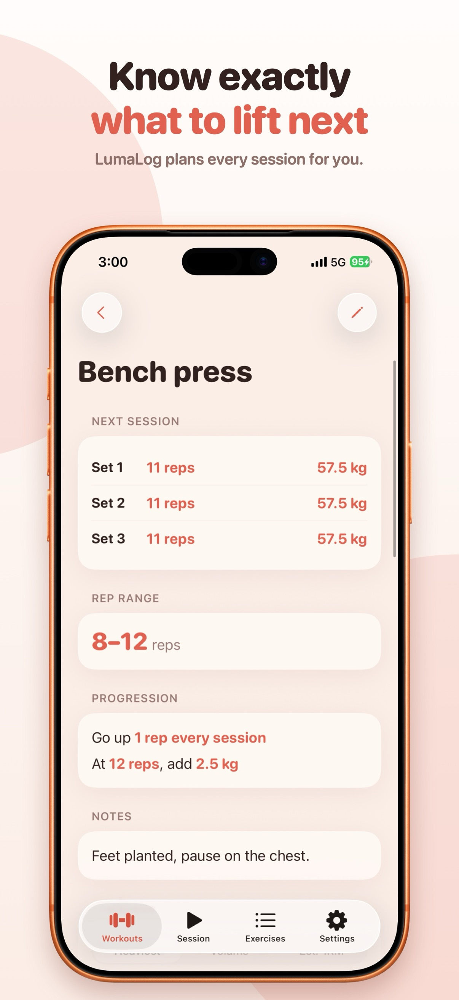
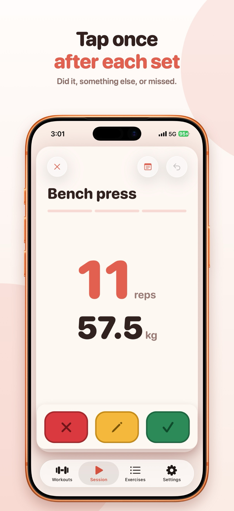
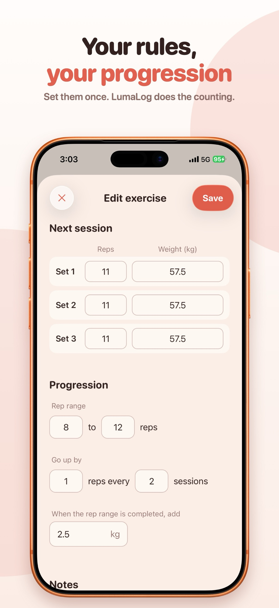
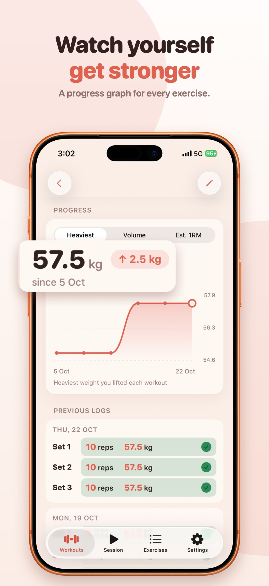
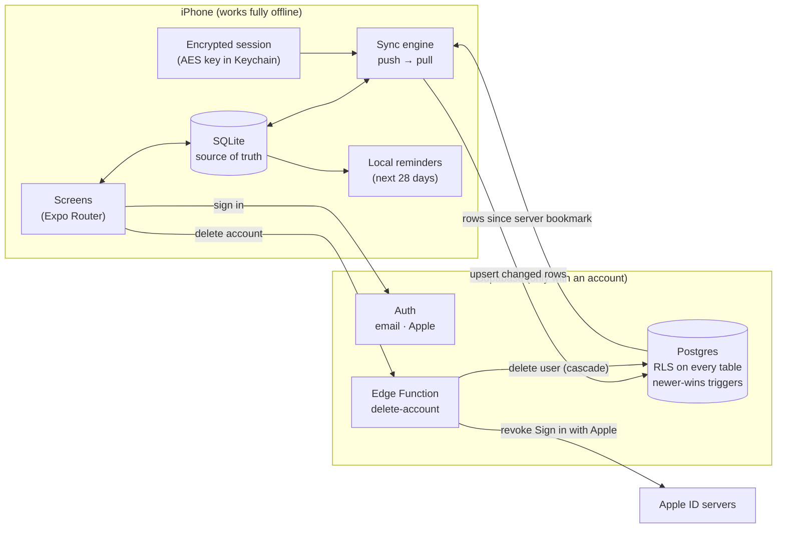

# LumaLog

**Set your progression rules once, tap one button after each set, and LumaLog plans your next session.**

An offline-first iOS workout tracker for progressive overload, built solo, from design to App Store.

**Coming soon to the App Store.**

> The app's source code is private. This repo shows what I built and how I designed it.

---

## Screenshots

| Next session | Logging a set | Progression rules | Progress |
|---|---|---|---|
|  |  |  |  |

---

## What it does

- **Per-exercise progression rules:** a rep range, how fast reps go up, and how much weight to add at the top.
- **One-tap logging:** after each set, tap *Did it*, *Other* or *Missed*. LumaLog moves the targets up when they're earned and holds them when they're not.
- **Works fully offline, no account needed.** An optional account backs up workouts and syncs them across devices.
- **Workout reminders** on chosen days, scheduled on the device (no server).
- **Progress graphs** per exercise: heaviest set, volume, or estimated one-rep max.
- **Resume mid-workout:** close the app and pick up exactly where you left off.
- Sign in with Apple or email, in-app account deletion, kg/lbs, light and dark mode.

---

## Tech stack

| Layer | Choice |
|---|---|
| App | React Native 0.88, Expo SDK 58, Expo Router (file-based navigation) |
| UI | Native SwiftUI components via `@expo/ui`, Reanimated 4, Gesture Handler 3 |
| Local data | SQLite (`expo-sqlite`), versioned schema migrations |
| Backend | Supabase: Postgres with row level security, Auth, Edge Functions (Deno/TypeScript) |
| Auth | Email + password, Sign in with Apple (nonce-verified) |
| Notifications | Local scheduled notifications (`expo-notifications`) |
| Build & release | EAS Build and Submit, TestFlight, App Store Connect |

---

## Architecture

The phone's database is always the main copy. Screens only ever read and write SQLite; the network is an optional background step that can fail without the user noticing.

---

## Engineering highlights

- **Offline-first by design.** No screen waits on the network. Without an account, nothing ever leaves the device.
- **A hand-written sync engine** instead of a sync library: incremental push and pull with per-account bookmarks, batched and paginated, and safe to interrupt at any point. → [docs/sync-engine.md](docs/sync-engine.md)
- **Conflict resolution on the server.** A Postgres trigger enforces "newer change wins" and ignores exact repeats, so an old phone can never overwrite a newer edit and rows don't ping-pong between devices.
- **Pull runs on the server's clock**, not the phone's, so a device with a wrong clock can't make another device miss rows.
- **Soft deletes everywhere,** so a delete made offline still reaches every other device.
- **Defence in depth on data access:** row level security on every table, no delete permission at all, signed-out visitors get nothing, and text limits enforced on both the client and the database. → [docs/security.md](docs/security.md)
- **The login is encrypted at rest:** the session is AES-encrypted, with the key kept in the iOS Keychain.
- **Apple-compliant account deletion:** a server function deletes the user (and all their rows, through cascades) and revokes Sign in with Apple.
- **Zero tracking:** no analytics SDK and no ads. Product questions are answered with App Store Connect metrics and plain SQL instead.
- **Reminders without a server:** notifications are rescheduled whenever anything changes, kept under iOS's limit of 64 pending notifications, and finishing a workout cancels the rest of that day's reminders.

---

## How I worked

- Built in small phases, each tested on a real device before the next (for example, sync went: server tables → local schema upgrade → push → pull → timing → sign-out).
- Wrote the privacy policy and terms myself, and kept the app's claims ("no tracking", "works offline") true in the code.
- Researched App Store search before naming the app, and designed the onboarding to teach by doing: you tap the real result buttons and watch the targets change.

---

## Docs

- [Sync engine and conflict resolution](docs/sync-engine.md)
- [Security: auth, sessions, RLS and account deletion](docs/security.md)

---

Built by Tarig Bashari · tarigdevapps@gmail.com
