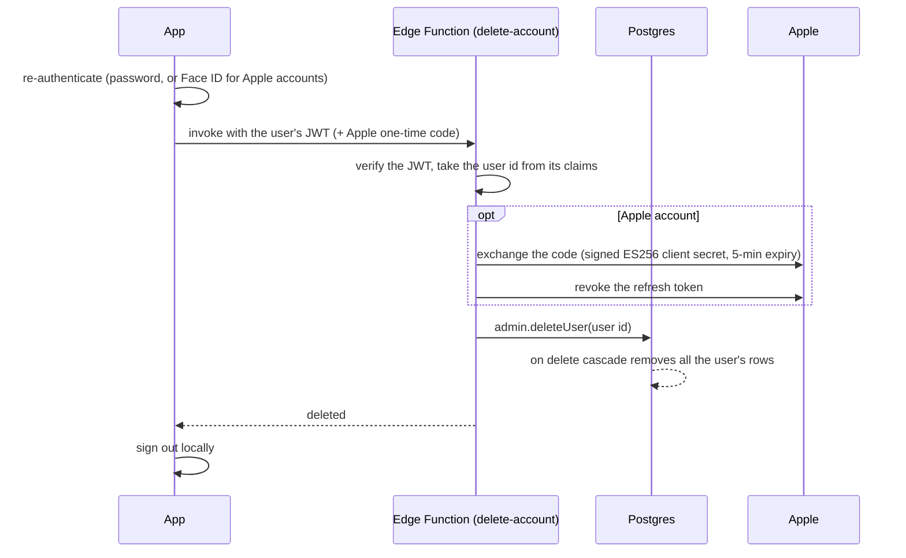

# Security

How LumaLog handles accounts, sessions, data access and account deletion.

## Principles

- **An account is optional.** Without one, workouts stay on the device and no network request carries user data.
- **The app holds no secrets.** It only ships the Supabase publishable key, which is public by design. Everything
  that needs a privileged key runs in a server-side Edge Function.
- **The database protects itself.** Access rules live in Postgres, not in app code, so a modified client can't read
  or change anyone else's data.
- **No tracking.** No analytics SDK, no ads, no third-party trackers.

## Authentication

**Email and password** through Supabase Auth, with:
- email confirmation required before the first sign-in
- a minimum password length
- password reset with a one-time code sent by email (the response never reveals whether an account exists)

**Sign in with Apple:**
1. The app generates a random **nonce** and gives Apple only its SHA-256 hash.
2. Apple returns a signed identity token containing that hash.
3. The app sends the token and the *original* nonce to Supabase, which checks they match.

This proves the token was issued for this sign-in and wasn't replayed from elsewhere. Only the email scope is
requested (users can choose Hide My Email), and the app never asks for names.

## Session storage: encrypted at rest

A Supabase session is too large for the iOS Keychain on its own, so the app uses an envelope approach:

1. Generate a random 256-bit key with a cryptographically secure generator.
2. Encrypt the session with AES using that key.
3. Store the **key** in the iOS Keychain (`expo-secure-store`) and the **ciphertext** in regular app storage.

Without the Keychain entry, the stored session is unreadable. A fresh key is generated each time the session is saved,
and sign-out deletes both halves.

Token auto-refresh only runs while the app is in the foreground, which saves battery and follows Supabase's guidance
for mobile apps.

## Data access: row level security

Every synced table in Postgres has:

| Rule | Effect |
|---|---|
| RLS enabled | No row is visible unless a policy allows it |
| `select` / `insert` / `update` policies | Only where `auth.uid() = user_id`. Updates also check the row still belongs to the user afterwards |
| `user_id` defaults to `auth.uid()` | The owner comes from the verified login token, not from anything the client claims |
| All privileges revoked from `anon` | Signed-out visitors get no access at all |
| **No `delete` grant** | Deletes are soft (`deleted_at`). A stolen session can't erase history |
| Length `check` constraints | Names ≤ 100 and notes ≤ 2000 characters, mirrored in the app so it never sends a row the server would reject |

Policies use `(select auth.uid())` so Postgres evaluates it once per query instead of once per row. Supabase's Security
Advisor reports no issues.

## Account deletion

Apple requires apps with accounts to offer deletion inside the app. The client can't delete users itself, because that
needs the service key, so a **Supabase Edge Function** does it:

- **Re-authentication first.** Email accounts confirm their password, and Apple accounts confirm with Face ID, which
  also supplies the one-time code needed to revoke Sign in with Apple.
- **The function only ever deletes the caller.** The user id comes from the verified token's claims, never from the
  request body, so nobody can delete someone else.
- **Deletion wins over revocation.** If Apple's revoke call fails, the account is still deleted (it's the user's
  right) and the failure is logged.
- The Apple signing key and IDs live only in Edge Function secrets, never in the app or the repository.
- Every row has `user_id` referencing the auth user **on delete cascade**, so one delete removes all their data.

## Secrets hygiene

- `.env` is git-ignored. It only holds the public project address and publishable key.
- Private keys (App Store Connect API, Sign in with Apple) live outside the repository, readable by my user account only.
- Two-factor authentication is on for the Supabase, GitHub and Apple developer accounts.
