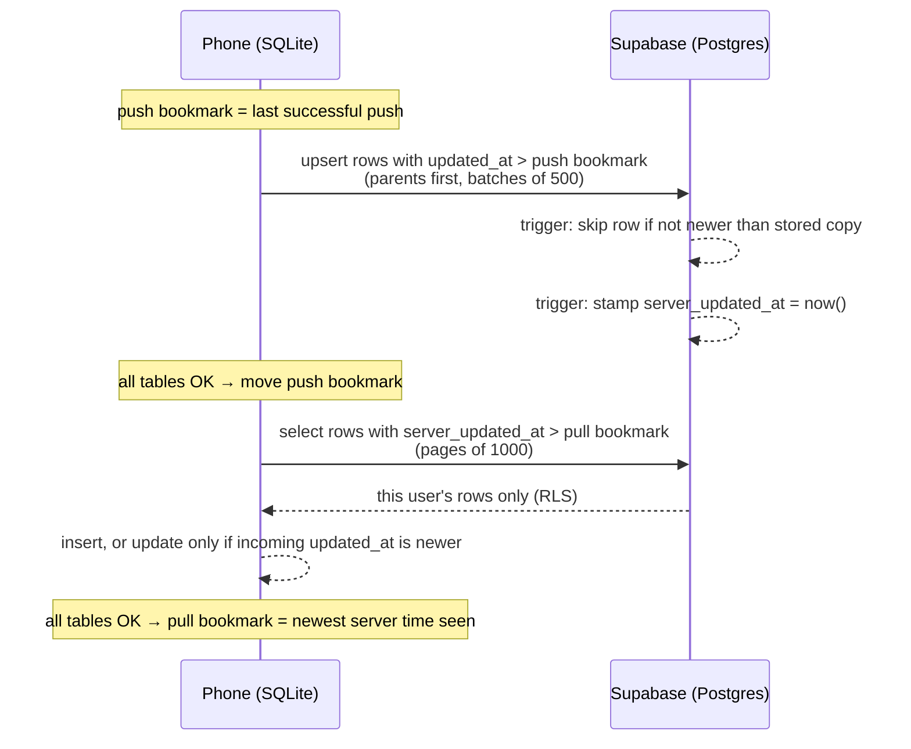

# Sync engine

How LumaLog keeps workouts in step across devices while working fully offline.

## Goals

1. **Offline first.** The phone's SQLite database is the source of truth. Screens never wait on the network.
2. **Optional.** Without an account, sync never runs and nothing leaves the device. Turning sync on later is just
   a first push of everything.
3. **Never lose a logged set.** Any sync can fail halfway (no signal at the gym) and the next one picks up cleanly.

I wrote it by hand instead of using a sync library, to keep the data model simple and to understand every failure mode.

## Data model

Six tables are synced: workouts, exercises, the links between them, each exercise's progression rule, the current
target for each set, and every logged set. Settings such as kg/lbs, appearance and the reminder level stay per device.

Every synced row carries:

| Column | Set by | Purpose |
|---|---|---|
| `id` (UUID) | phone | Created offline, so two devices can never clash |
| `updated_at` | phone | When the row last changed. Decides conflicts |
| `deleted_at` | phone | Soft delete. The row is marked, never erased, so the delete can reach other devices |
| `user_id` | server | Filled from the login token |
| `server_updated_at` | server | When the server received the row. Drives pull |

## One sync = push, then pull

**Push first**, so this device's changes reach the server before it asks for everyone else's.

### Push
- Note the time *before* reading anything. A row edited during the push gets a later `updated_at`, so the next push
  sends it. Nothing slips through the gap.
- Send each table's changed rows, parent tables first, as batched upserts keyed on `user_id` + the row's key.
- Only if **every** table succeeds does the bookmark move forward. Any error means the next push simply resends
  the same rows. Upserts are idempotent, so resending is harmless.
- Bookmarks are stored **per account**, so if a different account signs in on the same phone, it gets a full first push.

### Pull
- Ask for this user's rows whose `server_updated_at` is after the pull bookmark, paginated.
- **The bookmark uses the server's clock, not the phone's.** If pull relied on device timestamps, a phone with its
  clock set wrong could upload rows "in the past", and other devices would never fetch them.
- Each table is written in one SQLite transaction: all rows or none.

## Conflict resolution: newer change wins

The same row edited on two devices resolves to the version with the later `updated_at`, and it's enforced in **two places**:

- **On the server**, a `BEFORE UPDATE` trigger returns `null` (skip the row, no error) when the incoming
  `updated_at` is older than **or equal to** the stored one. An offline iPad syncing yesterday's edit can't
  overwrite today's.
- **On the phone**, pull's upsert only updates a local row when the incoming version is strictly newer. A local edit
  that hasn't been pushed yet is kept.

**Why "or equal to" matters.** In the first version the trigger only skipped *older* rows. Once devices pulled, a
phone would push back a row it had just received, with the same `updated_at`. The server counted that as a change,
stamped a new `server_updated_at`, and every device pulled the same row again, so rows bounced between devices
forever. Treating an identical version as a no-op fixed it.

Triggers run in name order, so the newer-wins check runs before the server-time stamp, and a skipped row doesn't get
a new server time either.

## When sync runs

Only when signed in: on app launch, when the app returns to the foreground, after sign-in, and after finishing a
workout. A module-level lock makes concurrent calls share the sync already running (for example, returning to the
app right after finishing a workout), so two syncs never interleave.

Sync never shows errors and never crashes the app. With no internet it fails quietly, and the bookmarks guarantee the
next attempt covers everything. Screens subscribe to a "new data pulled" event to reload their lists.

## Sign-out

1. Sync first. If that fails, the user is warned that unsynced changes will be lost and chooses whether to continue.
2. End the session on **this device only**, so other devices stay signed in.
3. Clear the synced tables and the sync bookmarks in one transaction, so the next person to sign in starts clean.

## Trade-offs I chose knowingly

- **Row-level last-write-wins, not field-level merging.** If two devices edit different fields of the same row
  offline, the newer row wins as a whole. For a personal workout log that's rare and acceptable, and logged sets are
  append-only rows, so they're never lost to a conflict.
- **`updated_at` comes from the device clock.** Conflicts between two devices with badly skewed clocks could pick the
  "wrong" winner. *Fetching* is safe either way, because pull uses server time.
- **No foreign keys between synced tables on the server.** Rows can arrive in any order across batches. Integrity is
  enforced on the device, and the only server-side foreign key is `user_id`, for account deletion.
- **Soft-deleted rows are kept,** so deletes propagate. A possible later clean-up: wipe a deleted row's contents
  immediately and purge the empty marker after 30 days.
